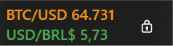

# ₿ Bitcoin Widget for Windows | pgmatheus-code

Um widget minimalista para Windows que exibe em tempo real:

- Bitcoin (BTC/USD)
- Dólar (USD/BRL)

O objetivo do projeto é recriar a simplicidade dos antigos gadgets do Windows 7 usando WPF e .NET, mantendo um visual discreto, moderno e sempre visível na área de trabalho.

---

## Preview

O widget permanece fixo sobre a área de trabalho e atualiza automaticamente as cotações utilizando dados públicos da Binance.

---

## Funcionalidades

✅ Exibição de BTC/USD em tempo real

✅ Exibição de USD/BRL em tempo real

✅ Janela sem bordas

✅ Sempre visível (TopMost)

✅ Cantos arredondados

✅ Atualização automática

✅ Consumo leve de memória

✅ Compatível com Windows 10 e Windows 11

---

## Controles

O widget inicia bloqueado para impedir movimentações acidentais.

### 🔒 Modo Bloqueado

- O widget permanece fixo na tela.
- Cliques com o botão esquerdo não movem a janela.

### 🔓 Modo Desbloqueado

- Clique com o botão direito para alternar entre bloqueado e desbloqueado.
- Quando desbloqueado, arraste normalmente usando o botão esquerdo do mouse.

| Ação | Resultado |
| --- | --- |
| Botão direito | Alterna entre bloqueado/desbloqueado |
| Arrastar com botão esquerdo | Move o widget (quando desbloqueado) |
| Alt \+ F4 | Fecha a aplicação |

---

## TradingView

O widget foi pensado para funcionar como um painel rápido de consulta enquanto o acompanhamento detalhado pode ser feito no TradingView.

O TradingView oferece gráficos avançados, indicadores técnicos e acompanhamento completo do mercado de criptomoedas.

---

## Tecnologias Utilizadas

- C\#
- WPF
- .NET
- HttpClient
- Binance API

---

## Estrutura do Projeto

BitcoinWidget

│

├── MainWindow.xaml

├── MainWindow.xaml.cs

├── App.xaml

├── App.xaml.cs

└── Assets

---

## Executando

A última versão se encontra compilada em:

\bin\Release\net10.0-windows

Mas você pode também clonar o repositório.

---

## Motivação

Este projeto nasceu da vontade de trazer de volta a praticidade dos gadgets do Windows 7 em uma solução moderna, leve e focada exclusivamente em informações úteis para o dia a dia de quem acompanha o mercado.

---

## Licença

Distribuído sob a licença MIT.

--- 

██████╗  ██████╗ ███╗   ███╗ █████╗ ████████╗
██╔══██╗██╔════╝ ████╗ ████║██╔══██╗╚══██╔══╝
██████╔╝██║  ███╗██╔████╔██║███████║   ██║
██╔═══╝ ██║   ██║██║╚██╔╝██║██╔══██║   ██║
██║     ╚██████╔╝██║ ╚═╝ ██║██║  ██║   ██║
╚═╝      ╚═════╝ ╚═╝     ╚═╝╚═╝  ╚═╝   ╚═╝
Bitcoin Widget for Windows
Created by pgmat
github.com/pgmatheus-code

